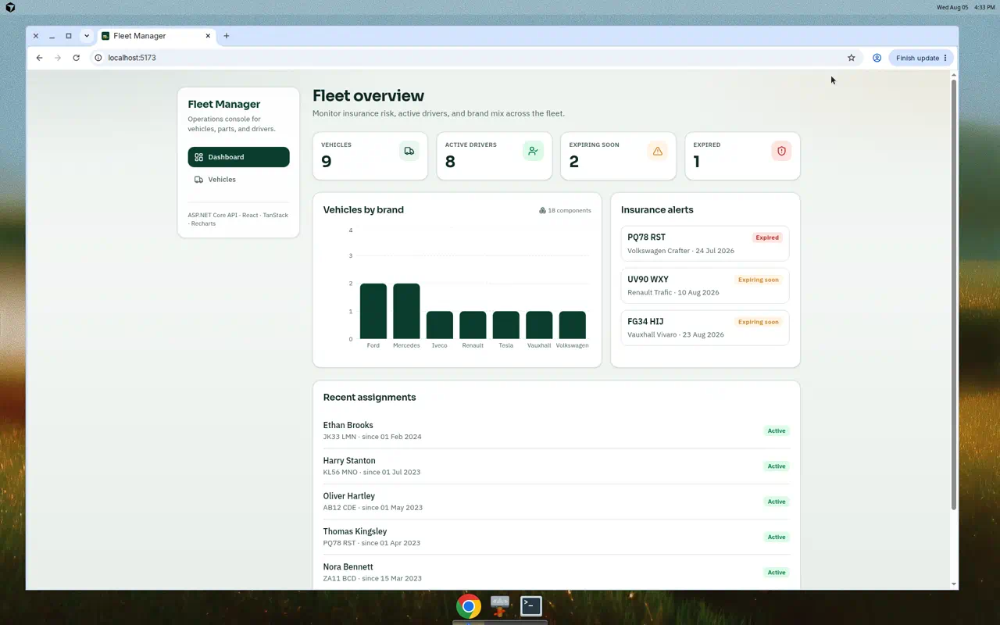
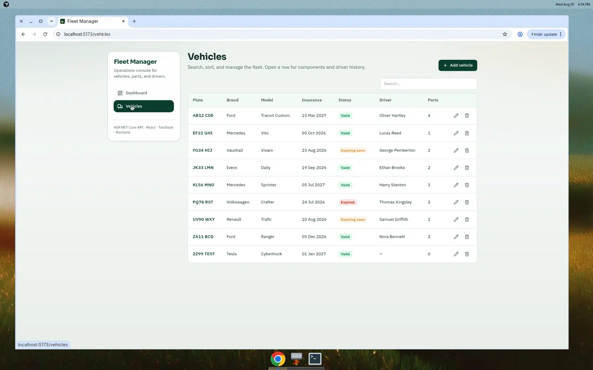
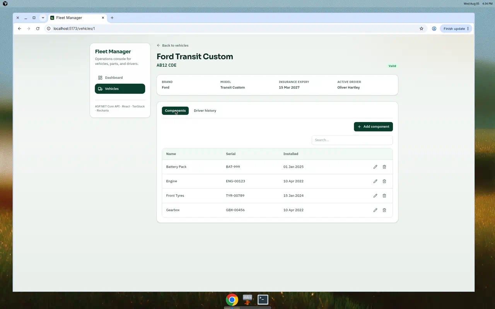

# Fleet Management System

A full-stack fleet management portfolio app: **ASP.NET Core 10 Web API** + **React (Vite/TypeScript)** SPA. Built to showcase modern, license-free engineering after removing the paid DevExtreme stack.

### App Preview

**1. Fleet Dashboard**


**2. Vehicles table**


**3. Vehicle detail**


## What changed

| Before | After |
|---|---|
| ASP.NET MVC + DevExtreme DataGrid/Form/Tabs | REST API + React SPA |
| Paid DevExtreme (jQuery / AspNet.Core) | TanStack Table, TanStack Query, Recharts, Lucide, Tailwind |
| Grid-only CRUD screens | Dashboard with KPIs/charts + searchable tables + master-detail |
| Form-encoded DevExtreme payload style | Standard JSON REST endpoints |

## Features

- **Dashboard** — fleet KPIs, insurance alerts, brand distribution chart, recent assignments
- **Vehicles** — search/sort table, create/edit/delete, insurance status badges
- **Vehicle detail** — components and driver history with full CRUD
- **Seeded SQLite data** — realistic sample fleet on first run
- **Zero paid UI licenses** — runs with open-source libraries only

## Tech stack

| Layer | Technology |
|---|---|
| API | ASP.NET Core 10, EF Core, SQLite, AutoMapper |
| SPA | React 19, TypeScript, Vite |
| Data UI | TanStack Table + TanStack Query |
| Charts | Recharts |
| Styling | Tailwind CSS 4 |

## Project layout

```text
/
├── Fleet Management System/   # ASP.NET Core Web API (+ serves SPA in publish)
├── client/                    # React Vite frontend
├── docs/                      # Screenshots / notes
└── README.md
```

## Getting started

### Prerequisites

- [.NET 10 SDK](https://dotnet.microsoft.com/download)
- [Node.js 20+](https://nodejs.org/)

### 1. API

```bash
cd "Fleet Management System"
dotnet restore
dotnet run --launch-profile http
```

API listens on `http://localhost:5090`.

### 2. Frontend (dev)

```bash
cd client
npm install
npm run dev
```

Vite runs on `http://localhost:5173` and proxies `/api` to the backend.

### 3. Production-style publish

```bash
cd "Fleet Management System"
dotnet publish -c Release
```

The publish target builds the React app and copies `client/dist` into `wwwroot`.

## API overview

| Method | Endpoint | Description |
|---|---|---|
| GET | `/api/dashboard` | Fleet overview metrics |
| GET/POST | `/api/vehicles` | List / create vehicles |
| GET/PUT/DELETE | `/api/vehicles/{id}` | Read / update / delete |
| GET/POST | `/api/vehicle-components?vehicleId=` | Components CRUD |
| GET/POST | `/api/driver-assignments?vehicleId=` | Assignments CRUD |

## Design notes

- Insurance status is derived server-side (`Valid` / `ExpiringSoon` / `Expired`) within a 30-day window.
- Controllers return typed JSON with camelCase property names.
- Cascade delete removes components and assignments when a vehicle is deleted.
