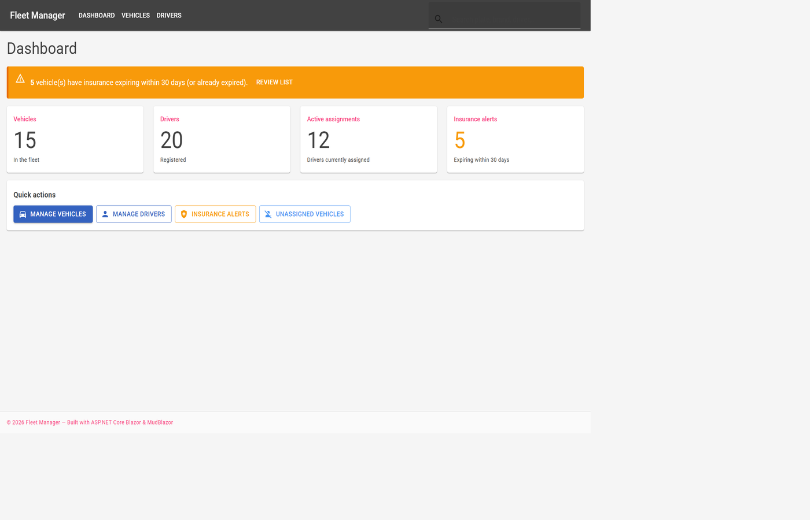
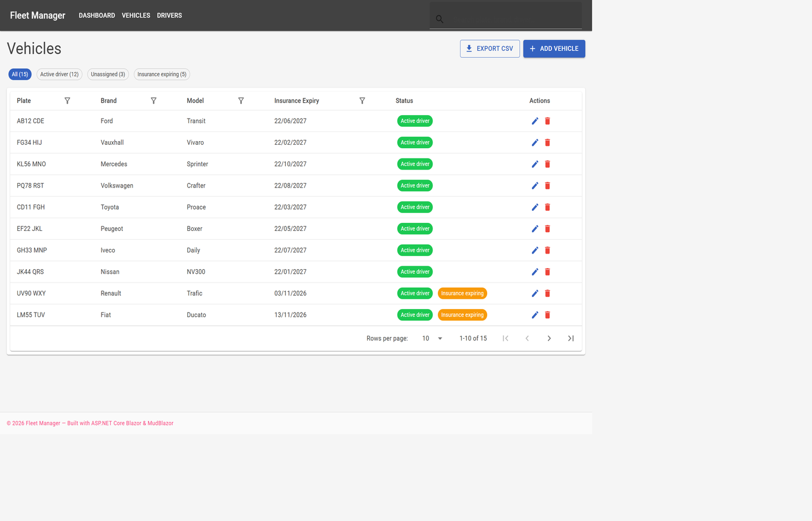
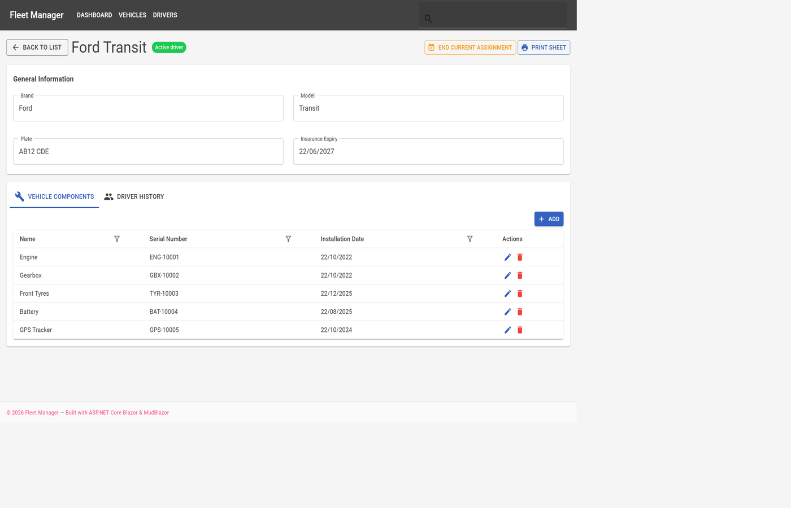
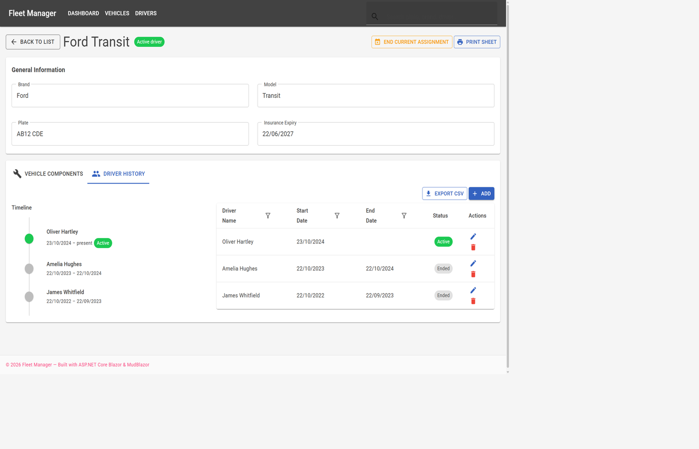
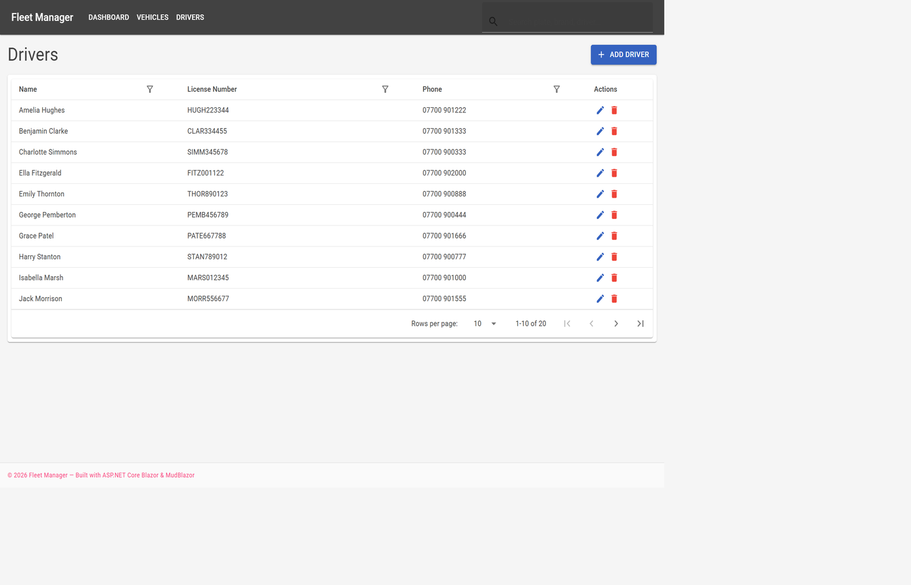

# Fleet Management System

A fleet management web application built as a junior full-stack portfolio project. The UI uses Blazor + MudBlazor; the same service layer powers both the interactive UI and a Minimal API.

## Overview

Manage a vehicle fleet from a clean Blazor UI: vehicles, components, drivers, and assignment history. A small dashboard surfaces totals and insurance alerts. Sample data is seeded automatically on first run.

### App Preview

**1. Dashboard**


**2. Vehicles list**


**3. Vehicle detail — Components**


**4. Vehicle detail — Driver history**


**5. Drivers list**


## Features

- Dashboard with vehicle / driver / assignment / insurance counters
- Vehicle CRUD with unique plate validation and status badges
- Vehicle detail page: components + driver assignment history
- Driver entity with dedicated list page
- Domain rules: one active assignment per vehicle, end date ≥ start date
- Minimal API REST endpoints reusing the same services as the UI
- Unit tests covering core business rules
- Automatic EF migrations + seed data on startup

## Architecture

```
Blazor UI (MudBlazor) ──┐
                        ├──► Services + DTOs ──► EF Core (SQLite)
Minimal API (/api/*) ───┘
```

| Layer | Technology |
|---|---|
| Framework | ASP.NET Core 10 Blazor (Interactive Server) |
| API | Minimal API |
| ORM | Entity Framework Core (SQLite) |
| UI | MudBlazor |
| Mapping | AutoMapper |
| Tests | xUnit + EF InMemory |

## Getting Started

### Prerequisites

- [.NET 10 SDK](https://dotnet.microsoft.com/download)

### Run

```bash
cd "Fleet Management System"
dotnet restore
dotnet run --launch-profile http
```

Open [http://localhost:5090](http://localhost:5090). On first start the app applies EF migrations and seeds sample vehicles, drivers, components, and assignments.

### Tests

```bash
dotnet test
```

### Docker

```bash
docker build -t fleet-manager .
docker run --rm -p 8080:8080 fleet-manager
```

Then open [http://localhost:8080](http://localhost:8080).

## API examples

Base URL: `http://localhost:5090`

```bash
# List vehicles
curl http://localhost:5090/api/vehicles

# Get one vehicle
curl http://localhost:5090/api/vehicles/1

# Create a vehicle
curl -X POST http://localhost:5090/api/vehicles ^
  -H "Content-Type: application/json" ^
  -d "{\"plate\":\"ZZ11 AAA\",\"brand\":\"Ford\",\"model\":\"Transit\",\"insuranceExpiry\":\"2027-01-01\"}"

# List drivers
curl http://localhost:5090/api/drivers

# Dashboard stats
curl http://localhost:5090/api/dashboard/stats

# Components for a vehicle
curl http://localhost:5090/api/vehicles/1/components

# Assignments for a vehicle
curl http://localhost:5090/api/vehicles/1/assignments
```

Main endpoint groups:

| Method | Path | Description |
|---|---|---|
| GET/POST | `/api/vehicles` | List / create vehicles |
| GET/PUT/DELETE | `/api/vehicles/{id}` | Vehicle by id |
| GET/POST | `/api/vehicles/{id}/components` | Components |
| GET/POST | `/api/vehicles/{id}/assignments` | Assignments |
| GET/POST | `/api/drivers` | Drivers |
| GET | `/api/dashboard/stats` | Dashboard counters |

## Decisions

- **Blazor Server** — interactive UI with C# end-to-end, good fit for an internal ops tool demo.
- **Minimal API** — lightweight REST surface that reuses the same services as the Blazor pages (full-stack without a separate API project).
- **SQLite** — zero-setup local database for portfolio demos; migrations keep the schema versioned.
- **Service layer + DTOs** — keeps UI/API thin and business rules (unique plate, single active assignment) testable in isolation.
